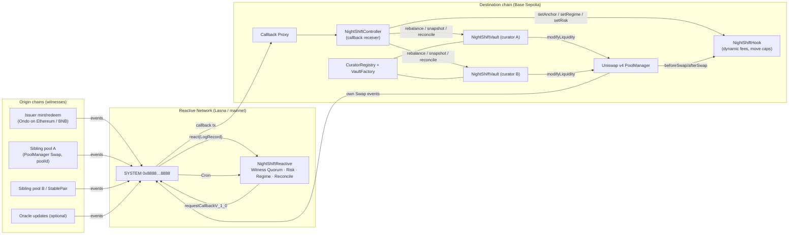
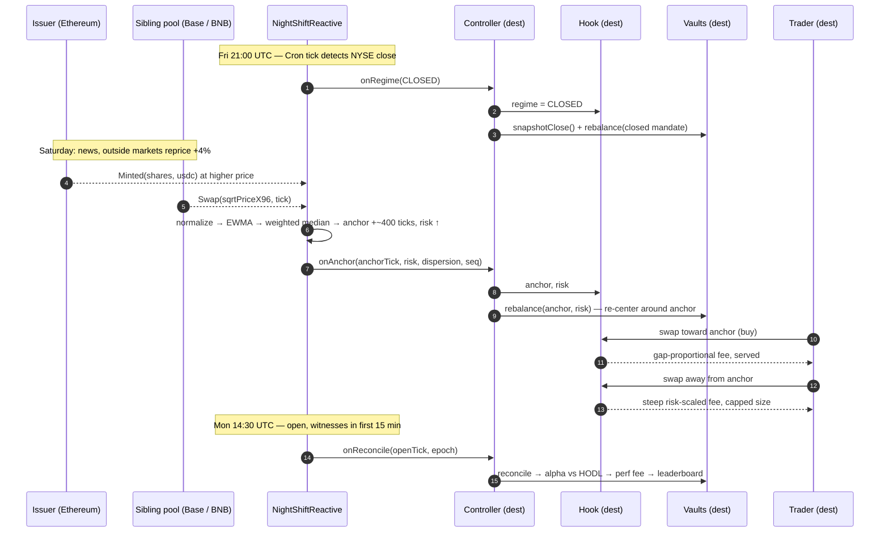

# NightShift

> **Curated liquidity for tokenized stocks while Wall Street sleeps.**
> A Uniswap v4 hook + Reactive Network system that brings the _stranded_ weekend price anchor of tokenized equities back to the pool, prices closed-market risk, and lets curators compete to keep liquidity alive — with their performance scored on-chain when the market reopens.

|                         |                                                                                      |
| ----------------------- | ------------------------------------------------------------------------------------ |
| **Event**               | Uniswap Hook Incubator, cohort 11 (UHI11) Hookathon                                  |
| **Theme**               | Active Management & Curated Liquidity                                                |
| **Sponsor integration** | Reactive Network (Omni) — mandatory, core to the design                              |
| **Hookathon window**    | 16 Nov 2026 → **3 Dec 2026, 11:59 pm PST** (final submission) · Demo Day 11 Dec 2026 |
| **Status**              | Spec complete, implementation starting. See `TODO.md`.                               |
| **License**             | MIT                                                                                  |

---

## How to use this document (read this first, Claude)

This README is the **single source of truth for the specification** — the _what_ and _why_. It is written so that an AI coding agent (Claude Code) can implement the project end-to-end.

1. **Start with `TODO.md`.** Phase 0 sets up project context: `CLAUDE.md` → Kiro steering files in `.kiro/steering/` (product, tech, structure, plus scoped files). Do not write contract code before Phase 0 is done.
2. Everything in §25 _Open questions & verification gates_ is **unverified**. Verify before you depend on it. When reality differs from this README, update this README and log the decision in `.kiro/steering/decisions.md`.
3. Parameter values in §9–§11 are **initial defaults to tune**, not truths. Keep them in config, never hard-coded inside logic.
4. Where this README names a library API (Reactive Omni lib, OpenZeppelin uniswap-hooks), **read the installed library source before coding against it** — names may have drifted.

---

## Table of contents

1. [Context: the hookathon and how we are judged](#1-context-the-hookathon-and-how-we-are-judged)
2. [The problem: the weekend anchor is stranded](#2-the-problem-the-weekend-anchor-is-stranded)
3. [Prior art and differentiation](#3-prior-art-and-differentiation)
4. [Solution overview](#4-solution-overview)
5. [System architecture](#5-system-architecture)
6. [Market regime model](#6-market-regime-model)
7. [Witness Quorum (Reactive)](#7-witness-quorum-reactive)
8. [Gap Risk Score](#8-gap-risk-score)
9. [Fee policy (the hook)](#9-fee-policy-the-hook)
10. [Curator marketplace and vaults](#10-curator-marketplace-and-vaults)
11. [Reopen reconciliation and performance fees](#11-reopen-reconciliation-and-performance-fees)
12. [Corporate actions](#12-corporate-actions)
13. [Contract specifications](#13-contract-specifications)
14. [Event and callback catalog](#14-event-and-callback-catalog)
15. [Security model and invariants](#15-security-model-and-invariants)
16. [Tech stack and libraries](#16-tech-stack-and-libraries)
17. [Repository structure](#17-repository-structure)
18. [Networks, chain IDs and addresses](#18-networks-chain-ids-and-addresses)
19. [Configuration and environment variables](#19-configuration-and-environment-variables)
20. [Build, test and deploy commands](#20-build-test-and-deploy-commands)
21. [Testing strategy](#21-testing-strategy)
22. [Dashboard, recorder and flow bot](#22-dashboard-recorder-and-flow-bot)
23. [Demo plan and live recording schedule](#23-demo-plan-and-live-recording-schedule)
24. [Hookathon deliverables checklist](#24-hookathon-deliverables-checklist)
25. [Open questions and verification gates](#25-open-questions-and-verification-gates)
26. [Glossary](#26-glossary)
27. [Credits and references](#27-credits-and-references)

---

## 1. Context: the hookathon and how we are judged

### 1.1 UHI11 theme

The UHI11 theme is **Active Management & Curated Liquidity**: hooks that let curators and automated strategies actively manage and rebalance liquidity — vault-managed or token-gated modules, curated LP networks where depositors follow professional managers, auto-rebalancing from off-chain signals or oracle triggers, and performance-fee / strategy-migration systems.

NightShift answers almost every bullet of that theme:

| UHI11 bullet                                              | NightShift component                                                                          |
| --------------------------------------------------------- | --------------------------------------------------------------------------------------------- |
| Vault-managed hook modules                                | `NightShiftVault` per curator, hook-aware                                                     |
| Curated LP networks (follow a manager)                    | `CuratorRegistry` + depositor migration between curators                                      |
| Auto-rebalancing from off-chain signals / oracle triggers | Reactive Witness Quorum → `onAnchor` callback → vault rebalance                               |
| Performance fees, backtesting, strategy migration         | Reopen reconciliation, alpha-vs-HODL fees with high-water mark, scenario replays, `migrate()` |

### 1.2 Our four project criteria (non-negotiable)

Every design decision must keep all four green:

1. **Solves a problem that is not solved yet** (or very likely not).
2. **Increases the number of transactions** on Uniswap.
3. **Fits the UHI11 theme.**
4. **Uses sponsor technology** — Reactive Network — doing real work, not decoration.

### 1.3 Reactive Network's own judging bar

Reactive judges integrations by three questions:

1. Is the subscription doing **real work**?
2. Would the project be **simpler without Reactive**? (The answer must be _no_.)
3. Did it **actually run**? Proven by a reactive transaction on Lasna/mainnet **plus the callback it produced on the destination chain**, visible in explorers.

At UHI9 only six projects cleared the "callback actually fired on-chain" floor. **Our first engineering milestone is a real callback landing on the destination chain.**

### 1.4 Atrium/UF judging lens

Uniswap Foundation cares about LP PnL, order-flow capture and effective liquidity. Every claim we make in the pitch must be backed by a metric from §21–§22.

---

## 2. The problem: the weekend anchor is stranded

### 2.1 Background

Tokenized US equities (Robinhood Stock Tokens, Ondo Global Markets, xStocks, …) trade 24/7 on-chain while the underlying market trades only during NYSE sessions. Data points (sources in §27):

- A majority of tokenized-stock DEX volume happens **outside US market hours** (reported 62%–71% in recent weeks).
- Tokenized stocks did **$3.96B in weekend DEX volume in September 2026**, ~106× November 2025.
- **Uniswap handles ~60%** of tokenized-stock DEX volume overall; on **Robinhood Chain** Uniswap handles ~99% of tokenized-stock trading and **v4 ~73%**.
- On Robinhood Chain, Robinhood's own mint/redeem window **closes** outside market hours.
- On 27 Oct 2026 Ondo made 11 tokenized stocks/ETFs **mintable and redeemable 24/7 on Ethereum and BNB Chain, including weekends**, bridged them to Robinhood Chain, and Uniswap launched **StablePair** pools pairing Ondo tokens with Robinhood tokens of the same underlying.
- Failure case: on 29–31 Aug 2026 a memecoin routed its main liquidity against tokenized Hims & Hers on Robinhood Chain; the wrapper printed **$61.15 against a $28.84 NYSE close (+112%)** and collapsed when minting reopened. None of the chain's top pools used a dynamic fee.

### 2.2 The reframed problem

> **The weekend price anchor is no longer missing — it is stranded on other chains.**

Executable, hard-to-fake price information exists during closed hours (issuer mint/redeem on Ethereum/BNB, sibling pools on several chains, StablePair pools, 24/7 oracle updates), but:

- A **Uniswap v4 hook only sees its own chain**, and
- A hook **only runs when someone trades** — it cannot react to information that arrives between trades.

Consequences in the pool: price drifts from fair value, LPs carry unpriced gap risk and pull liquidity on Friday, spreads widen, large trades revert or route elsewhere, volume leaves Uniswap.

### 2.3 Why this needs Reactive (and nothing simpler)

The fix requires a component that **subscribes to events on many chains at once, computes on them, and pushes state into the pool between trades** — without a trusted off-chain server or signer. That is exactly a reactive contract. Without Reactive we would need one bot per chain plus an aggregator server, re-introducing the trusted signer we want to avoid.

---

## 3. Prior art and differentiation

Know the field; cite it in the pitch.

| Project                                                    | What it does                                                                                                                                                   | What it leaves open                                                                                                                                                                                                                              | NightShift's answer                                                                                                                                         |
| ---------------------------------------------------------- | -------------------------------------------------------------------------------------------------------------------------------------------------------------- | ------------------------------------------------------------------------------------------------------------------------------------------------------------------------------------------------------------------------------------------------ | ----------------------------------------------------------------------------------------------------------------------------------------------------------- |
| **Gapguard** (Robinhood Chain, MIT)                        | On-chain NYSE calendar; closed-market surcharge, drift surcharge vs. a time-weighted "last close" anchor; ~1% max move per swap while closed. Live on mainnet. | Closed-market prices get **zero weight** — anchor is blind to the outside world; large swaps **revert**; LPs may still leave ("if LPs pull liquidity for the weekend, the pool gets thin"); unscheduled closures and **stock splits** are rigid. | Anchor built from **witnessed** cross-chain markets; repair flow is served, not reverted; vaults keep liquidity alive; corporate actions via issuer events. |
| **Maestro** (UHI9, Reactive)                               | Reactive contract subscribes to a Pyth feed and re-centers a pool's liquidity between trades.                                                                  | Single **signed** feed; crypto asset trading 24/7; no regime model; no curator layer.                                                                                                                                                            | Multi-source quorum, regime-aware, curator marketplace with scored performance.                                                                             |
| **Chainlink 24/7**                                         | Weekend pricing for tokenized assets (extended-hours data + perp quotes).                                                                                      | A **price**, not a liquidity policy; signed; the hook still sleeps between trades.                                                                                                                                                               | Used as one low-weight witness inside the quorum (complement, not competitor).                                                                              |
| **StablePair (Uniswap) + Ondo 24/7 mint/redeem**           | Route between Ondo and Robinhood tokens; Ondo can mint/redeem on weekends on Ethereum/BNB.                                                                     | Arbitrage path is slow and costly (swap → bridge → redeem); pools on Robinhood Chain still can't _see_ the anchor.                                                                                                                               | Treat these as the **strongest witnesses** and bring their information to the pool instantly.                                                               |
| **Arrakis Price Convergence**                              | Aligns pools to a reference price at rebalance.                                                                                                                | Reference goes stale when the market is closed.                                                                                                                                                                                                  | Reference is the witnessed quorum, regime-aware.                                                                                                            |

**One-line differentiation:** Gapguard decides _who gets paid_ when the market is closed; NightShift keeps the market _working at a fair price_ when it is closed — and makes curators accountable for it.

---

## 4. Solution overview

### 4.1 The pitch

> The weekend price anchor of tokenized stocks isn't missing — it's stranded on other chains. NightShift uses Reactive to bring a **quorum of witnesses**, led by issuer execution, into Uniswap pools, then lets **curators compete** to keep liquidity alive while Wall Street sleeps — with performance **scored on-chain** when the market reopens.

### 4.2 Four layers (+1)

1. **Witness Quorum (Reactive).** A reactive contract on Reactive Network subscribes to events on several origin chains (issuer mint/redeem, sibling Uniswap pools, StablePair pools, optional oracle updates) and on the destination pool itself. It normalizes each observation into the destination pool's tick space, smooths it, weights it by how hard it is to fake, computes a weighted median **anchor tick**, and sends callbacks to the destination chain **between trades**.
2. **Gap Risk Score.** A 0–10 000 bps risk score built from time since the last open-market anchor, witness dispersion, pool-vs-anchor divergence and quorum staleness. While the market is closed it **can only ratchet up**; it resets at reconciliation.
3. **Curator marketplace.** Curators deploy vaults with **per-regime mandates** (open / closed / reopen): how closely to follow the anchor, range widths, risk-scaled widening, recenter thresholds. Mandate changes are timelocked. Depositors pick a curator and can migrate between curators of the same pool.
4. **Reopen reconciliation.** The first regular-session witnessed price (the _open tick_) scores each vault's closed-market performance against HODL. Performance fees are paid only on positive alpha above a high-water mark. Results form an on-chain leaderboard.
5. **(+1) Corporate actions.** Issuer multiplier/split events are subscribed to and applied as a controlled halt + anchor rescale + forced vault recenter.

### 4.3 How it increases transactions

- LPs no longer need to flee on Friday → depth survives the weekend.
- Swaps that repair the price toward the anchor are **served** (modest, gap-proportional fee) instead of reverted.
- Swaps that push the price away from fair value pay steep, risk-scaled fees and are size-capped → LPs are paid for gap risk, so they stay.
- Fair prices on Uniswap during the hours that already carry the majority of tokenized-stock volume → more routing to Uniswap.

### 4.4 Non-goals

- Not an oracle product; we do not publish prices for others.
- No real securities in our own demo pools; demo tokens only (§23).
- No custody, no KYC logic (Robinhood/OKX permissioning is out of scope).
- No Solana/non-EVM witnesses (Reactive is EVM-only).
- No upgradeable proxies.

---

## 5. System architecture

### 5.1 Component diagram



### 5.2 Sequence: a news weekend



### 5.3 Trust model

- **No off-chain signer in the data path.** Inputs are on-chain events witnessed by Reactive; computation is a deterministic Solidity contract on Reactive Network.
- **Destination accepts state only from the callback proxy carrying our reactive contract's identity** (see §15).
- **Defense in depth:** the destination keeps an on-chain NYSE calendar and an anchor-staleness rule, so if Reactive is late or down, the hook degrades to maximal protection (Gapguard-like behavior) instead of trusting stale state.

---

## 6. Market regime model

### 6.1 States

| Regime           | Meaning                                                                      | Entered when                                         |
| ---------------- | ---------------------------------------------------------------------------- | ---------------------------------------------------- |
| `OPEN`           | NYSE regular session (09:30–16:00 ET), or 09:30–13:00 ET on early-close days | Calendar says open **and** previous epoch reconciled |
| `CLOSED`         | Weeknights, weekends, NYSE holidays, after early close                       | Calendar says closed                                 |
| `REOPEN_PENDING` | Market has opened but reconciliation hasn't completed                        | Calendar transitions closed → open                   |
| `HALTED`         | Corporate action being applied, or emergency                                 | Corporate action callback / guardian                 |

Transitions: `OPEN → CLOSED → REOPEN_PENDING → OPEN`; any state → `HALTED` → previous state (bounded by `maxHaltDuration`).

### 6.2 Calendar (`NyseCalendar` library)

- Pure Solidity, rule-based: US Eastern Time with DST (second Sunday of March → first Sunday of November), weekends, NYSE full-day holidays (New Year's, MLK, Presidents', Good Friday via Easter computation, Memorial, Juneteenth, Independence, Labor, Thanksgiving, Christmas, with weekend observance rules) and 13:00 ET early closes (day before Independence Day when applicable, day after Thanksgiving, Christmas Eve when applicable).
- Plus an owner-managed, **timelocked** override list for unscheduled closures.
- Port the rules from Gapguard (MIT) or `horsefacts/trading-days` (MIT) **with attribution**; verify against the official NYSE holiday table for 2026–2027 in tests.
- The same library is compiled into both `NightShiftReactive` (to detect transitions on Cron) and `NightShiftController` (fallback `syncRegime()`).

### 6.3 Who changes the regime

1. **Primary:** `NightShiftReactive` on every Cron tick evaluates the calendar for `block.timestamp`; on a transition it requests an `onRegime` callback (no debounce for regime changes).
2. **Fallback:** anyone can call `NightShiftController.syncRegime(poolId)`, which evaluates the same calendar on the destination chain. This prevents a Reactive delay from leaving the pool in the wrong regime.
3. `REOPEN_PENDING → OPEN` happens only via `onReconcile` (or `forceReconcile` after `reconcileTimeout`, using the latest anchor).

> Reference times for the hookathon period (EST, UTC−5): regular session = **14:30–21:00 UTC**; early close = **18:00 UTC**.

---

## 7. Witness Quorum (Reactive)

### 7.1 Source types

| Kind                            | Event                                                                                                                                                                                          | Price extraction                   | Default weight                              | Rationale                                                             |
| ------------------------------- | ---------------------------------------------------------------------------------------------------------------------------------------------------------------------------------------------- | ---------------------------------- | ------------------------------------------- | --------------------------------------------------------------------- |
| `ISSUER_MINT` / `ISSUER_REDEEM` | Issuer mint/redeem event (shape TBD, see §25)                                                                                                                                                  | `quoteAmount / shareAmount` → tick | **5**                                       | Primary execution with real capital at issuer price — hardest to fake |
| `V4_SWAP`                       | `PoolManager.Swap(bytes32 indexed id, address indexed sender, int128 amount0, int128 amount1, uint160 sqrtPriceX96, uint128 liquidity, int24 tick, uint24 fee)` filtered by `topic_1 = poolId` | `tick` (post-swap)                 | **3** (StablePair) / **2** (other siblings) | Real markets, but single pools can be pushed                          |
| `V3_SWAP`                       | Uniswap v3 / Pancake `Swap(...)`                                                                                                                                                               | `tick`                             | **2**                                       | Same as above                                                         |
| `ORACLE`                        | Aggregator `AnswerUpdated(int256 indexed current, uint256 indexed roundId, uint256 updatedAt)` or equivalent                                                                                   | answer → tick                      | **1**                                       | Signed source — comparison only                                       |
| `SELF`                          | Destination pool's own `Swap`                                                                                                                                                                  | `tick`                             | **0** (never in anchor)                     | Used for divergence in the risk score                                 |

Any v4 pool on any supported chain can be a witness **without our hook**: we only subscribe to the canonical `PoolManager` `Swap` event filtered by `poolId`. This includes third-party pools (e.g. real StablePair pools).

### 7.2 Source config

```solidity
struct WitnessSource {
    uint256 chainId;          // origin chain
    address emitter;          // PoolManager / pool / issuer / aggregator
    uint256 topic0;           // event signature hash
    uint256 topic1;           // poolId filter for V4_SWAP, else REACTIVE_IGNORE
    SourceKind kind;
    bool    invert;           // source token order is reversed vs destination
    int24   offsetTicks;      // decimals + quote-unit + multiplier adjustment into destination tick space
    uint16  weight;           // base weight
    uint128 minNotional;      // ignore swaps/mints below this quote notional (in source quote units)
    uint32  maxAgeOpen;       // seconds an observation stays fresh while OPEN
    uint32  maxAgeClosed;     // … while CLOSED
    bool    enabled;
}
```

Sources are added/removed by the owner on Reactive Network; adding a source calls `SYSTEM.subscribe(...)` (one subscription per criteria set — Omni has no OR inside a subscription).

### 7.3 Normalization (everything in destination tick space)

- 1 tick = ×1.0001 ≈ 1 bp. Working in ticks makes medians and distances cheap and unit-free.
- `destTick = (invert ? -srcTick : srcTick) + offsetTicks`.
- For issuer events: `ratio = quoteAmount * 10^baseDecimals / (shareAmount * 10^quoteDecimals)` → `sqrtPriceX96 = sqrt(ratio · 2^192)` (FullMath + `Math.sqrt`) → `TickMath.getTickAtSqrtPrice` → apply `invert`/`offsetTicks`.
- `offsetTicks` is computed **off-chain at configuration time** by a script (`script/ComputeOffsets.s.sol` or TS helper) and unit-tested; it encodes decimals differences, stablecoin quote differences (assumed at parity — see §15 depeg note) and issuer multipliers.

### 7.4 Per-source smoothing and influence caps

On each observation `x` (dest ticks) for source `s` at time `t`:

1. **Notional filter:** drop if notional < `minNotional`.
2. **Influence cap:** `x' = clamp(x, anchor − J, anchor + J)` where `J = maxJumpTicks` (default 300). Prevents one print from teleporting the source.
3. **Time-weighted EWMA:** `α = 1 − 2^(−Δt / halfLife)` (approximate with a fixed-point lookup or `1 − exp`), `ewma_s ← ewma_s + α · (x' − ewma_s)`; default `halfLife = 300 s`. First observation initializes `ewma_s = x'`.
4. Store `lastSeen_s = t`, `lastRaw_s = x`.

### 7.5 Quorum and anchor

For the current regime `r`, a source is **fresh** if `now − lastSeen_s ≤ maxAge_s(r)`. Effective weight `w_eff = weight_s · freshness`, with linear decay `freshness = 1 − age / maxAge` (floor at 0).

- **Quorum reached** iff Σ `w_eff` ≥ `minQuorumWeight` (default 4) **and** fresh sources span ≥ `minDistinctChains` (default 2).
- **Anchor** = weighted median of `ewma_s` over fresh sources (insertion-sort; cap `MAX_SOURCES = 16`).
- **Dispersion** = weighted mean absolute deviation of fresh `ewma_s` from the anchor (ticks).
- No quorum → anchor is **not** updated; status `DEGRADED`; risk keeps rising through the staleness component.

### 7.6 When to send a callback

Request `onAnchor` iff quorum reached **and** any of:

- `|anchor − lastSentAnchor| ≥ minAnchorDeltaTicks` (default 10), or
- risk bucket changed (buckets of 500 bps), or
- heartbeat elapsed (`heartbeat`, default 30 min, evaluated on Cron),

and `now − lastCallbackAt ≥ minCallbackInterval` (default 60 s). Regime, reconcile and corporate-action callbacks bypass the debounce. Every callback carries a monotonically increasing `seq`.

### 7.7 Open price for reconciliation

On `CLOSED → REOPEN_PENDING`, the reactive contract opens an **open window** (default 15 min). The open tick = weighted median of observations **inside the window**, with issuer weight boosted ×2. When the window closes with quorum → `onReconcile(openTick, epochId)`. Without quorum by `reconcileTimeout` (default 60 min) → `onReconcile` with the latest anchor and `degraded = true`.

---

## 8. Gap Risk Score

### 8.1 Components (each normalized to [0, 1], then weighted; weights sum to 10 000)

| Component  | Formula                                     | Full-scale default   | Weight     |
| ---------- | ------------------------------------------- | -------------------- | ---------- | -------------------- | ---- |
| Time       | `min(1, (now − lastOpenAnchorAt) / H_full)` | `H_full` = 64 h      | 3000       |
| Dispersion | `min(1, dispersionTicks / D_full)`          | `D_full` = 200 ticks | 2500       |
| Divergence | `min(1,                                     | selfTick − anchor    | / V_full)` | `V_full` = 300 ticks | 3000 |
| Staleness  | `min(1, (now − lastQuorumAt) / S_full)`     | `S_full` = 4 h       | 1500       |

`raw = Σ weight_i · component_i` (bps, 0–10 000).

### 8.2 Ratchet (closed-market risk only grows)

- In `CLOSED` (and `REOPEN_PENDING`/`HALTED`, until reconciliation): `risk = max(risk, raw)` — **trades in our own pool can never lower it.** (ADR-012)
- In `OPEN`: `risk = raw` (no ratchet).
- At reconciliation: `risk = 0`, `lastOpenAnchorAt = now`.

### 8.3 Where it lives

Computed on Reactive (it has all inputs) and pushed with `onAnchor`. The hook stores it and **additionally** computes the live divergence locally from the current tick at swap time, so a delayed callback can't make fees too cheap: `riskUsed = max(storedRisk, localDivergenceComponent)`.

---

## 9. Fee policy (the hook)

Fees are LP fees in **pips** (1 000 000 = 100%), applied through v4 dynamic fees: the pool is created with `fee = LPFeeLibrary.DYNAMIC_FEE_FLAG`; `beforeSwap` returns `fee | LPFeeLibrary.OVERRIDE_FEE_FLAG`. All surcharges accrue to the liquidity that actually fills the swap — no lump sum for JIT liquidity to capture.

### 9.1 Direction

Let `d = currentTick − anchorTick` (before the swap). `zeroForOne` moves the tick down.

- `|d| ≤ deadbandTicks` (default 5) → **neutral** (treated as toward).
- `toward` ⇔ (`zeroForOne` and `d > 0`) or (`!zeroForOne` and `d < 0`).
- otherwise `away`.

### 9.2 Fee schedule

| Regime           | Toward anchor                                  | Away from anchor                                                                       |
| ---------------- | ---------------------------------------------- | -------------------------------------------------------------------------------------- |
| `OPEN`           | `baseOpen`                                     | `baseOpen + driftSlopeOpen · absD` (small)                                             |
| `CLOSED`         | `baseClosed + captureShare · absD / 100`       | `baseClosed + riskFeeMax · riskUsed / 10 000 + min(driftMax, driftSlope · (absD + maxAwayMove/2))` |
| `REOPEN_PENDING` | `baseOpen + reopenSurcharge`                   | same as CLOSED away                                                                    |
| `HALTED`         | revert `MarketHalted()`                        | revert `MarketHalted()`                                                                |

`absD = |currentTick − anchorTick|`. `captureShare` is in bps and 1 tick ≈ 1 bp = 100 pips, so `captureShare · absD / 100` pips (ADR-012). All fees capped at `maxFeeClosed`.

- **Toward = repair flow.** It is informed arbitrage that moves the pool to fair value. We **serve** it and recapture a share of the gap for LPs (`captureShare`, default 30% of the gap: a 200 bp gap → +60 bp fee; the arbitrageur still keeps ~140 bp, so the price converges).
- **Away = pushing price away from fair value** (e.g. the HIMS-style squeeze). It pays steeply, scaled by risk, priced at the midpoint of a full allowed step so splitting a swap never makes the move cheaper (idea from Gapguard, MIT).
- Global caps: `maxFeeClosed` (default 50 000 = 5%), hard cap `MAX_FEE = 100 000` (10%) enforced at construction.

### 9.3 Move caps (enforced in `afterSwap`)

- `away` swaps while `CLOSED`/`REOPEN_PENDING`: `|tickAfter − tickBefore| ≤ maxAwayMove · (1 − riskUsed / 20 000)` (default `maxAwayMove` = 100 ticks ≈ 1%) else revert `AwayMoveTooLarge()`.
- `toward` swaps may overshoot the anchor by at most `overshootCap` (default 20 ticks) else revert `Overshoot()`.
- Large toward swaps are therefore served in full up to the anchor — the core difference from a blanket move cap.

### 9.4 Stale-anchor fallback

If `block.timestamp − anchorUpdatedAt > anchorMaxAge(regime)` (defaults: 30 min open, 6 h closed) **or** no anchor was ever set:

- every swap is treated as `away` with `riskUsed = 10 000`.
- The hook emits `AnchorStale(poolId)` once per stale period.

### 9.5 Default parameters (initial, tune via scenarios)

| Param             | Default      | Notes                 |
| ----------------- | ------------ | --------------------- |
| `baseOpen`        | 3 000        | 0.30%                 |
| `baseClosed`      | 3 000        | 0.30%                 |
| `driftSlopeOpen`  | 2 pips/tick  | gentle                |
| `captureShare`    | 3 000 bps    | 30% of the gap        |
| `riskFeeMax`      | 10 000       | +1.00% at risk 10 000 |
| `driftSlope`      | 20 pips/tick | 0.002%/tick           |
| `driftMax`        | 45 000       | 4.5%                  |
| `maxFeeClosed`    | 50 000       | 5%                    |
| `reopenSurcharge` | 1 000        | 0.10%                 |
| `deadbandTicks`   | 5            |                       |
| `maxAwayMove`     | 100 ticks    |                       |
| `overshootCap`    | 20 ticks     |                       |

Parameters are per pool (`PoolConfig`), set at `afterInitialize` from a registered config and changeable only by the pool admin via timelock (default 24 h).

---

## 10. Curator marketplace and vaults

### 10.1 Roles

| Role                          | Can                                                                                          | Cannot                                                             |
| ----------------------------- | -------------------------------------------------------------------------------------------- | ------------------------------------------------------------------ |
| **Curator**                   | Deploy a vault via `VaultFactory`; queue mandate changes (timelocked); earn performance fees | Move funds out; call `rebalance` with arbitrary ticks; change fees |
| **Depositor**                 | Deposit/withdraw in-kind; migrate between vaults of the same pool                            | —                                                                  |
| **Controller** (Reactive-fed) | Push anchor/regime/risk to hook; call `rebalance`, `snapshotClose`, `reconcile` on vaults    | Anything else                                                      |
| **Pool admin** (multisig)     | Register pools, set `PoolConfig` (timelocked), pause in emergency                            | Touch vault funds                                                  |

### 10.2 Mandate (per regime)

```solidity
struct RegimeMandate {
    uint16 followBps;          // 0–10 000: center = poolTick + followBps·(anchor − poolTick)/10 000
    uint24 coreHalfWidth;      // ticks, before risk widening
    uint24 wideHalfWidth;      // ticks, backstop position
    uint16 coreShareBps;       // share of deployable liquidity in the core position
    uint16 riskWidenBps;       // width multiplier at risk 10 000: width·(1 + riskWidenBps·risk/10^8)
    uint24 recenterThreshold;  // ticks: only rebalance if center moved ≥ this or width changed ≥ this
    uint16 exitRiskBps;        // if risk ≥ this, pull the core position (keep wide only)
}

struct Mandate {
    RegimeMandate open;
    RegimeMandate closed;
    RegimeMandate reopen;
    uint16 perfFeeBps;         // ≤ MAX_PERF_FEE (2 000 = 20%)
}
```

Presets shipped in `script/` and the dashboard: **Conservative** (wide, follow 100%, exit at high risk), **Balanced**, **Aggressive** (narrow, follow 100%, high capture).

Mandate changes: `queueMandate(m)` → applicable after `mandateTimelock` (default 24 h) via `applyMandate()`; never mid-`CLOSED` epoch (applies at next `OPEN`).

### 10.3 Vault mechanics

- One vault = one pool, one curator, ERC-20 shares (OpenZeppelin `ERC20`), `ReentrancyGuard`.
- Holds idle `token0/token1` + up to two positions (`core`, `wide`) owned by the vault in the PoolManager (distinct `salt`s), managed through `poolManager.unlock()` + `unlockCallback` + `modifyLiquidity`, settling deltas with `CurrencySettler`.
- **Deposits and withdrawals are in-kind and pro-rata** (like an LP token): deposit `amount0Max, amount1Max` → shares minted at the vault's current composition ratio (refund excess); withdraw burns shares and returns pro-rata liquidity + idle of both tokens. **No price is needed for flows**, so stale-price NAV games are impossible.
- **No swaps by the vault.** Inventory imbalance is tolerated; imbalanced tokens sit in the wide position or idle.
- `rebalance(anchorTick, riskBps, regime)` (only Controller):
  1. Pick mandate for `regime`.
  2. If `riskBps ≥ exitRiskBps` → remove core, keep wide.
  3. Else compute `center`, widths (risk-widened), round to `tickSpacing`.
  4. If `|center − currentCenter| < recenterThreshold` and width change < threshold → no-op (emit `RebalanceSkipped`).
  5. Remove core (and wide if its range must move), re-add with available balances (single-sided ranges are fine — they act as resting liquidity at fair prices).
- Why it protects LPs: liquidity is moved **off stale prices and onto the witnessed fair price**, so informed traders cannot pick the vault off at stale prices; repair flow trades against the vault near fair value.

### 10.4 Registry, leaderboard and migration

- `CuratorRegistry`: curator profiles (name/URI), vault list per pool (cap `MAX_VAULTS_PER_POOL = 8`), per-epoch results, cumulative alpha per share, epochs played, best/worst epoch.
- `migrate(fromVault, toVault, shares, amount0Min, amount1Min)`: withdraw in-kind from `from`, deposit into `to` in one transaction; leftovers refunded.
- Optional curator bond (in quote token) is **out of scope for v1**; noted as future work.

---

## 11. Reopen reconciliation and performance fees

### 11.1 Epochs

An **epoch** = one closed period (e.g. Fri close → Mon open, or Wed close → Thu open). `epochId` increments on each `CLOSED` entry.

### 11.2 Close snapshot

On `onRegime(CLOSED)` the Controller calls `vault.snapshotClose(epochId)`: record per-share composition `(a0, a1)` = (position amounts at current `sqrtPriceX96` + idle) / `totalSupply`. Because flows are in-kind pro-rata, per-share composition is unaffected by deposits/withdrawals during the epoch.

### 11.3 Reconcile at open

On `onReconcile(openTick, epochId)`:

```
P_open        = price at openTick (quote per base)
hodlPerShare  = a0_close · P_open + a1_close                    // quote units
navPerShare   = (amounts of positions valued at openTick + idle) / totalSupply
alphaPerShare = navPerShare − hodlPerShare                       // can be negative
cumAlpha     += alphaPerShare
if cumAlpha > hwm:
    feeQuotePerShare = perfFeeBps · (cumAlpha − hwm) / 10 000
    mint shares to curator worth feeQuotePerShare · totalSupply at navPerShare
    hwm = cumAlpha
emit EpochReconciled(vault, epochId, navPerShare, hodlPerShare, alphaPerShare, feeShares, degraded)
registry.record(...)
```

Valuation uses the **witnessed open tick**, never the pool's own spot.

### 11.4 Benchmarks shown in the dashboard (not used for fees)

- **Passive control pool:** same tokens, static 0.30% fee, no hook, same initial liquidity.
- **Gapguard-style control pool:** our own minimal re-implementation of closed surcharge + ~1% move cap (credited, MIT) — `ControlClosedSurchargeHook` in `src/mocks/`.

---

## 12. Corporate actions

- Witness source kind `ISSUER_ACTION` subscribes to the issuer's multiplier/split event (shape TBD; mocked on testnet as `MultiplierUpdated(uint256 oldMultiplier, uint256 newMultiplier, uint256 effectiveAt)`).
- Flow: `onCorporateAction(ratioNum, ratioDen, effectiveAt)` → Controller sets `HALTED` → hook rescales anchor (`anchorTick += tickOf(ratio)`) and all source `offsetTicks` are updated on Reactive → Controller forces full recenter of all vaults → `HALTED` lifts after the next valid anchor or `maxHaltDuration` (default 30 min).
- This closes Gapguard's stated limitation that splits need more repricing than its closed-market cap allows.

---

## 13. Contract specifications

> Solidity style: custom errors, NatSpec on all externals, `immutable` where possible, no proxies, events for every state change. Exact library names (`BaseHook`, `AbstractCallback`, `AbstractReactive`, modifiers) **must be checked against installed sources**.

### 13.1 Destination chain

#### `NightShiftHook` (`contracts/src/hook/NightShiftHook.sol`)

- Inherits OpenZeppelin uniswap-hooks `BaseHook` (or v4-periphery `BaseHook`, whichever the template ships).
- Permissions: `afterInitialize`, `beforeAddLiquidity`, `beforeSwap`, `afterSwap`. No return-delta flags.
- Address mined with `HookMiner` for those flags; deployed via CREATE2 deployer `0x4e59b44847b379578588920cA78FbF26c0B4956C`.
- State per `PoolId`:
  ```solidity
  struct PoolState {
      int24  anchorTick;
      uint40 anchorUpdatedAt;
      uint16 riskBps;
      uint16 dispersionTicks;
      Regime regime;
      uint64 lastSeq;
      bool   curatedOnly;   // if true, only registered vaults may add liquidity
  }
  ```
- Externals:
  - `setState(PoolId, int24 anchorTick, uint16 riskBps, uint16 dispersion, uint64 seq)` — `onlyController`, requires `seq > lastSeq`.
  - `setRegime(PoolId, Regime, uint64 seq)` — `onlyController`.
  - `applyCorporateAction(PoolId, int24 tickShift, uint64 seq)` — `onlyController`.
  - `quoteFee(PoolKey, bool zeroForOne) view returns (uint24 fee, bool away)` — for routers/quoters and the dashboard.
- Hooks:
  - `afterInitialize`: revert unless `key.fee == DYNAMIC_FEE_FLAG`; load `PoolConfig` from registry.
  - `beforeAddLiquidity`: if `curatedOnly`, require `sender` is a registered vault.
  - `beforeSwap`: compute fee (§9), stash `tickBefore` and `away` in **transient storage**, return override fee.
  - `afterSwap`: enforce move caps (§9.3), emit `SwapObserved(poolId, tickBefore, tickAfter, fee, away)`.
- Errors: `NotController`, `StaleSeq`, `MarketHalted`, `AwayMoveTooLarge`, `Overshoot`, `NotDynamicFee`, `NotCuratedVault`.

#### `NightShiftController` (`contracts/src/controller/NightShiftController.sol`)

- Inherits Reactive Omni `AbstractCallback` (destination-side). Constructor takes the chain's **callback proxy** address and the expected **reactive contract** identity.
- Every callback function's **first parameter is `address`** (placeholder `address(0)` on the reactive side, overwritten by the callback proxy with the reactive contract's identity). Authorize with BOTH lib modifiers (verified G0.3/E): `onlyServiceProvider` (`msg.sender == callbackProxy`) **and** `onlyCallbackSender(reactive_)` (`firstArg == expectedReactive`). Never omit `onlyServiceProvider` — see `docs/verification.md`.
- Callbacks (all `onlyReactive`):
  - `onAnchor(address, bytes32 poolId, uint64 seq, int24 anchorTick, uint16 riskBps, uint16 dispersionTicks, uint8 sources, uint40 observedAt)` → `hook.setState` → for each vault of the pool: `try vault.rebalance(...)` (failures emit `VaultRebalanceFailed`, never revert the callback).
  - `onRegime(address, bytes32 poolId, uint64 seq, uint8 regime, uint40 effectiveAt)` → `hook.setRegime`; on `CLOSED` start epoch + `vault.snapshotClose`; on `REOPEN_PENDING` nothing else.
  - `onReconcile(address, bytes32 poolId, uint64 epochId, int24 openTick, uint40 openAt, bool degraded)` → each `vault.reconcile` → `hook.setRegime(OPEN)`.
  - `onCorporateAction(address, bytes32 poolId, uint64 seq, uint32 ratioNum, uint32 ratioDen, uint40 effectiveAt)`.
- Permissionless safety: `syncRegime(bytes32 poolId)` (calendar fallback), `forceReconcile(bytes32 poolId)` after `reconcileTimeout` using last anchor.
- Funding: must hold/repay callback costs per Reactive rules (verify mechanism — §25).

#### `NightShiftVault` + `VaultFactory` (`contracts/src/vault/`)

- See §10.3. Externals: `deposit(uint256 a0Max, uint256 a1Max, uint256 minShares, address to)`, `withdraw(uint256 shares, uint256 a0Min, uint256 a1Min, address to)`, `rebalance(int24, uint16, Regime)` (onlyController), `snapshotClose(uint64)` (onlyController), `reconcile(uint64, int24, bool)` (onlyController), `queueMandate(Mandate)`/`applyMandate()` (onlyCurator), views `positions()`, `composition()`, `navAt(int24 tick)`.
- `unlockCallback(bytes)` — only PoolManager.
- `VaultFactory.create(PoolKey, Mandate, string name, string symbol)` → registers in `CuratorRegistry`.

#### `CuratorRegistry` (`contracts/src/registry/CuratorRegistry.sol`)

- `registerPool(PoolKey, PoolConfig, bool curatedOnly)` (admin), `queuePoolConfig`/`applyPoolConfig` (timelocked).
- `registerVault(...)` (factory only), `vaultsOf(PoolId)`, `isVault(address)`.
- `record(EpochResult)` (vault only) and leaderboard views.
- `migrate(...)` helper.

#### Libraries (`contracts/src/libraries/`)

| Library            | Responsibility                                                                                    |
| ------------------ | ------------------------------------------------------------------------------------------------- |
| `NyseCalendar.sol` | ET/DST conversion, holidays, early closes, `regimeAt(uint256 ts)`, `nextTransition(uint256 ts)`   |
| `PriceMath.sol`    | ratio → sqrtPriceX96 → tick; tick → price; source normalization                                   |
| `WitnessMath.sol`  | clamp, EWMA (fixed point), weighted median, weighted MAD                                          |
| `RiskMath.sol`     | components, weights, ratchet                                                                      |
| `FeeMath.sol`      | direction, fee schedule, move caps                                                                |
| `Types.sol`        | enums (`Regime`, `SourceKind`), structs (`PoolConfig`, `Mandate`, `WitnessSource`, `EpochResult`) |

### 13.2 Reactive Network

#### `NightShiftReactive` (`contracts/src/reactive/NightShiftReactive.sol`)

- Solidity `^0.8.29`, inherits Omni `AbstractReactive`; `react(IReactive.LogRecord calldata log_) external onlySystem` (verified: `calldata`, not `memory` — see `docs/verification.md` G0.3).
- `SYSTEM = ISystemContract(payable(0x8888888888888888888888888888888888888888))`.
- Subscriptions: one per witness source (`SYSTEM.subscribe(chainId, emitter, topic0, topic1, REACTIVE_IGNORE, REACTIVE_IGNORE)`), one for the destination pool's own `Swap` (`SELF`), issuer action events, and **Cron100** (verified: legacy sys contract `0x00..fffFfF`, topic0 `0xb49937fb…1503c70`, ~2 min, bills every tick — see `docs/verification.md` G0.3).
- State: `sources[]`, per-source `{ewma, lastSeen, lastRaw}`, per-pool `{anchor, risk, regime, epochId, lastSentAnchor, lastCallbackAt, seq, openWindow buffer}`.
- `react` dispatch:
  - Cron → evaluate calendar (regime transition?), heartbeat, open-window close, reconcile timeout.
  - Witness event → decode by `kind`, update source, recompute quorum/anchor/risk, maybe callback.
  - `SELF` swap → update divergence component.
  - Issuer action → corporate action flow.
- Callbacks via `SYSTEM.requestCallbackV_1_0(ISystemContract.CallbackConfiguration_V_1_0({chainId, recipient: controller, gasLimit, payload}))`, payload = `abi.encodeWithSelector(IController.onAnchor.selector, address(0), ...)`.
- Admin (owner on Reactive): `addSource`, `disableSource`, `setParams`, `setController`, `pause`. Funded with REACT (lREACT on Lasna).
- Gas limits (defaults): `onAnchor` 2 500 000 (loops vaults), `onRegime` 1 500 000, `onReconcile` 2 500 000, `onCorporateAction` 2 500 000. Tune from measurements.

### 13.3 Origin-chain mocks (testnet only)

| Contract                     | Purpose                                                                                                                                                                                                                                                                     |
| ---------------------------- | --------------------------------------------------------------------------------------------------------------------------------------------------------------------------------------------------------------------------------------------------------------------------- |
| `DemoToken`                  | ERC-20 with owner mint; `dSTOCK` (18 dec) and `dUSD` (6 dec) on each testnet                                                                                                                                                                                                |
| `MockIssuer`                 | `mint(shares)`/`redeem(shares)` at an owner-set price; emits `Minted(address indexed to, uint256 shares, uint256 quoteAmount)`, `Redeemed(address indexed from, uint256 shares, uint256 quoteAmount)`, `MultiplierUpdated(uint256 oldM, uint256 newM, uint256 effectiveAt)` |
| Sibling pools                | Plain Uniswap v4 pools (no hook) of `dSTOCK/dUSD` on Ethereum Sepolia and Base Sepolia                                                                                                                                                                                      |
| `ControlClosedSurchargeHook` | Gapguard-style comparison hook (credited)                                                                                                                                                                                                                                   |

---

## 14. Event and callback catalog

### 14.1 Subscribed (origin → Reactive)

| Name                  | Signature                                                          | topic0                                       | Filter               |
| --------------------- | ------------------------------------------------------------------ | -------------------------------------------- | -------------------- |
| v4 Swap               | `Swap(bytes32,address,int128,int128,uint160,uint128,int24,uint24)` | `keccak256` of signature (compute in script) | `topic_1 = poolId`   |
| Mock mint             | `Minted(address,uint256,uint256)`                                  | computed                                     | emitter = MockIssuer |
| Mock redeem           | `Redeemed(address,uint256,uint256)`                                | computed                                     | emitter = MockIssuer |
| Mock action           | `MultiplierUpdated(uint256,uint256,uint256)`                       | computed                                     | emitter = MockIssuer |
| Cron                  | system cron event                                                  | per Reactive docs                            | system               |
| Real issuer (mainnet) | **TBD — Gate 0**                                                   |                                              |                      |

### 14.2 Callbacks (Reactive → destination Controller)

| Callback            | Trigger                                                           | Debounced |
| ------------------- | ----------------------------------------------------------------- | --------- |
| `onAnchor`          | quorum + (Δanchor ≥ threshold or risk bucket change or heartbeat) | yes       |
| `onRegime`          | calendar transition on Cron                                       | no        |
| `onReconcile`       | open window closed with quorum, or timeout                        | no        |
| `onCorporateAction` | issuer action event                                               | no        |

### 14.3 Emitted on destination

`AnchorUpdated(poolId, seq, anchorTick, riskBps, dispersion, sources)`, `RegimeChanged(poolId, from, to, seq)`, `AnchorStale(poolId)`, `SwapObserved(poolId, tickBefore, tickAfter, fee, away)`, `VaultRebalanced(vault, center, coreLower, coreUpper, wideLower, wideUpper)`, `RebalanceSkipped(vault, reason)`, `VaultRebalanceFailed(vault, reason)`, `CloseSnapshot(vault, epochId, a0PerShare, a1PerShare)`, `EpochReconciled(...)`, `MandateQueued/Applied`, `Deposit`, `Withdraw`, `Migrated`, `CorporateActionApplied`.

### 14.4 Emitted on Reactive

`WitnessObserved(sourceId, rawTick, ewmaTick)`, `QuorumComputed(poolId, anchor, dispersion, weight, distinctChains)`, `CallbackRequested(kind, poolId, seq)`.

---

## 15. Security model and invariants

### 15.1 Threats and mitigations

| Threat                                              | Mitigation                                                                                                                            |
| --------------------------------------------------- | ------------------------------------------------------------------------------------------------------------------------------------- |
| Forged callbacks                                    | Controller accepts only `msg.sender == callbackProxy` **and** first-arg identity `== reactive contract`; hook accepts only Controller |
| Replay / reordering                                 | Monotonic `seq` per pool; `epochId` must match current epoch                                                                          |
| Witness manipulation (pushing one sibling pool)     | Weighted median, per-source influence cap, EWMA, `minNotional`, ≥2 chains quorum, issuer weight highest                               |
| Stale data / Reactive outage                        | Anchor max-age → maximal protection; calendar fallback `syncRegime`; `forceReconcile`                                                 |
| Curator abuse                                       | Curator never moves funds or picks ticks; mandate bounds + timelock; perf fee cap; HWM                                                |
| Depositor timing games                              | In-kind pro-rata flows; valuation only at witnessed open tick                                                                         |
| Hook DoS by failing vault                           | `try/catch` per vault; vault cap per pool                                                                                             |
| Reentrancy                                          | `nonReentrant` on vault externals; PoolManager-only `unlockCallback`                                                                  |
| Fee misconfiguration                                | Hard caps checked at construction/config; timelocked config                                                                           |
| Stablecoin depeg (USDC vs USDT quotes in witnesses) | Documented assumption; optional per-source `enabled` toggle; future: stable/stable witness                                            |
| Unscheduled market closure                          | Timelocked override list in calendar; Reactive stale rules                                                                            |

### 15.2 Invariants (fuzz + invariant tests)

1. Hook state changes only via Controller; Controller only via authenticated callbacks (or the permissionless fallbacks).
2. `fee ≤ maxFeeClosed ≤ MAX_FEE` always.
3. During `CLOSED`, stored `riskBps` is non-decreasing.
4. Anchor is updated only with quorum.
5. Vault: `sum(withdrawable of all holders) ≤ assets held`; no function lets the curator transfer tokens out.
6. Performance fee only when `cumAlpha > hwm`; `perfFeeBps ≤ 2 000`.
7. `seq` strictly increasing per pool.

### 15.3 Disclaimers

Unaudited hackathon code. Demo pools use demo tokens only. Keep mainnet liquidity tiny and say so in the UI and README.

---

## 16. Tech stack and libraries

### 16.1 Contracts

| Tool / lib                                 | Use                                                            | Install                                                     |
| ------------------------------------------ | -------------------------------------------------------------- | ----------------------------------------------------------- |
| Foundry (forge, cast, anvil)               | build, test, scripts                                           | `curl -L https://foundry.paradigm.xyz \| bash && foundryup` |
| `Uniswap/v4-core`                          | PoolManager, types, `LPFeeLibrary`, `TickMath`                 | `forge install Uniswap/v4-core`                             |
| `Uniswap/v4-periphery`                     | `HookMiner`, `LiquidityAmounts`, test routers                  | `forge install Uniswap/v4-periphery`                        |
| `OpenZeppelin/uniswap-hooks`               | `BaseHook`, `CurrencySettler`                                  | `forge install OpenZeppelin/uniswap-hooks`                  |
| `OpenZeppelin/openzeppelin-contracts` (v5) | `ERC20`, `ReentrancyGuard`, `Ownable2Step`, `Math`, `SafeCast` | `forge install OpenZeppelin/openzeppelin-contracts`         |
| `Reactive-Network/reactive-lib-omni`       | `AbstractReactive`, `AbstractCallback`, `ISystemContract`      | `forge install Reactive-Network/reactive-lib-omni`          |
| `foundry-rs/forge-std`                     | tests                                                          | default                                                     |
| Slither                                    | static analysis                                                | `pip install slither-analyzer`                              |

Compiler: our destination contracts `pragma solidity ^0.8.26;` with `evm_version = "cancun"` (transient storage). Reactive contract `pragma solidity ^0.8.29;` in its own Foundry profile (`[profile.reactive]`; confirm the EVM version Reactive Omni supports). Let Foundry auto-detect solc for dependencies. Starting point for layout and remappings: `uniswapfoundation/v4-template` (compare, don't blindly copy).

### 16.2 Off-chain

| Tool                                                                           | Use                                                                             |
| ------------------------------------------------------------------------------ | ------------------------------------------------------------------------------- |
| Node.js ≥ 20, pnpm                                                             | workspace                                                                       |
| TypeScript, `viem`                                                             | recorder, flow bot, scripts                                                     |
| `better-sqlite3` (or JSONL)                                                    | event store for recordings                                                      |
| Next.js (App Router) + `wagmi` + `viem` + TanStack Query + Tailwind + Recharts | dashboard                                                                       |
| GitHub Actions                                                                 | CI: `forge fmt --check`, `forge build`, `forge test`, `pnpm lint`, `pnpm build` |

Pin exact versions in `package.json` / lockfile at install time; record them in `.kiro/steering/tech.md`.

---

## 17. Repository structure

```
nightshift/
├── CLAUDE.md                     # entry point for Claude Code → imports Kiro steering
├── README.md                     # this spec
├── TODO.md                       # task list (Phase 0 = context setup)
├── LICENSE                       # MIT
├── Makefile                      # common commands (§20)
├── .env.example
├── .gitignore
├── .kiro/
│   └── steering/
│       ├── product.md            # always
│       ├── tech.md               # always
│       ├── structure.md          # always
│       ├── glossary.md           # always
│       ├── decisions.md          # manual (ADR log)
│       ├── solidity.md           # fileMatch contracts/**/*.sol
│       ├── uniswap-v4-hook.md    # fileMatch contracts/src/hook/**
│       ├── reactive.md           # fileMatch contracts/src/reactive/**, controller/**
│       ├── vault-curation.md     # fileMatch contracts/src/vault/**, registry/**
│       ├── testing.md            # fileMatch contracts/test/**
│       ├── security.md           # fileMatch contracts/src/**
│       ├── frontend.md           # fileMatch app/**
│       ├── recorder.md           # fileMatch recorder/**
│       └── hookathon.md          # manual (deadlines, submission, pitch)
├── .claude/
│   └── rules/                    # thin bridges: paths: frontmatter + @import of the matching Kiro file
├── contracts/
│   ├── foundry.toml
│   ├── remappings.txt
│   ├── src/
│   │   ├── hook/NightShiftHook.sol
│   │   ├── controller/NightShiftController.sol
│   │   ├── vault/{NightShiftVault,VaultFactory}.sol
│   │   ├── registry/CuratorRegistry.sol
│   │   ├── reactive/NightShiftReactive.sol
│   │   ├── libraries/{NyseCalendar,PriceMath,WitnessMath,RiskMath,FeeMath,Types}.sol
│   │   ├── interfaces/{INightShiftHook,INightShiftController,INightShiftVault,ICuratorRegistry}.sol
│   │   └── mocks/{DemoToken,MockIssuer,ControlClosedSurchargeHook,MockSystemContract}.sol
│   ├── script/
│   │   ├── 00_DeployTokens.s.sol
│   │   ├── 01_DeployOrigins.s.sol          # MockIssuer + sibling pools
│   │   ├── 02_DeployDestination.s.sol      # registry, hook (mined), controller, factory, pool, control pools
│   │   ├── 03_DeployReactive.s.sol         # NightShiftReactive + sources
│   │   ├── 04_SeedLiquidity.s.sol
│   │   ├── 05_CreateCuratorVaults.s.sol    # 3 presets
│   │   └── ComputeOffsets.s.sol
│   └── test/
│       ├── unit/        # libraries, hook, controller, vault, registry, reactive
│       ├── fuzz/
│       ├── invariant/
│       ├── integration/ # ReactiveHarness end-to-end (local)
│       └── scenarios/   # S1–S8 replays + three-pool comparison
├── recorder/            # TS: event recorder, flow bot, report generator
├── app/                 # Next.js dashboard
├── deployments/
│   ├── testnet.json
│   └── mainnet.json
└── docs/
    ├── architecture.md
    ├── demo-script.md
    ├── pitch.md
    └── recordings/      # exported CSV/JSON + charts from live runs
```

Naming: contracts `PascalCase`, libraries `PascalCase`, tests `Contract.t.sol` / `Scenario_S1_NormalWeekend.t.sol`, scripts numbered.

---

## 18. Networks, chain IDs and addresses

> Verified from official docs on 18 Nov 2026. **Re-verify before deploying** (Uniswap warns addresses differ per chain).

### 18.1 Reactive Network

| Network                  | Chain ID | RPC                            | System contract                              | Explorer                      |
| ------------------------ | -------- | ------------------------------ | -------------------------------------------- | ----------------------------- |
| Reactive Lasna (testnet) | 5318007  | `https://lasna-rpc.rnk.dev/`   | `0x8888888888888888888888888888888888888888` | `https://lasna.reactscan.net` |
| Reactive Mainnet         | 1597     | `https://mainnet-rpc.rnk.dev/` | `0x8888888888888888888888888888888888888888` | `https://reactscan.net`       |

Testnet funding: lREACT faucet contract on Ethereum Sepolia `0x9b9BB25f1A81078C544C829c5EB7822d747Cf434` (send SepETH → receive lREACT on Lasna; verify rate/limits in docs). Mainnets and testnets must not be mixed.

### 18.2 Reactive callback proxies (destination side)

| Chain            | Chain ID | Callback proxy                               |
| ---------------- | -------- | -------------------------------------------- |
| Unichain Sepolia | 1301     | `0x775c9B990ADe401060B78D0e98684eEf8d2466C1` |
| Base Sepolia     | 84532    | `0x476F44b11F5C942c58f4c8E3d0300E5710743585` |
| Ethereum Sepolia | 11155111 | `0xAa14d9Cd0f788Ca23d11805986C1d8bd035D23b4` |
| Robinhood Chain  | 4663     | `0x476F44b11F5C942c58f4c8E3d0300E5710743585` |
| Ethereum         | 1        | `0xFCE1F192F489c988392aBC16E91e359d540d94Fe` |
| BSC              | 56       | `0xfc41eE9d3A836b41399BEcce83b06B3e5650f3BB` |
| Base             | 8453     | `0xCc780DdE33f56f55dE778D42c930959374a4a068` |
| Unichain         | 130      | `0x754120EC7a6eF81E4c5c835AA603C63Da64693E6` |
| Arbitrum         | 42161    | `0xaee8d2deBaB5bE353bfec167C58a549923892e11` |

Supported testnets (origin + destination): Base Sepolia, Ethereum Sepolia, Unichain Sepolia, Lasna. **Robinhood Chain and BSC are mainnet-only on Reactive.**

### 18.3 Uniswap v4 deployments

| Chain                   | PoolManager                                  | PositionManager                              | StateView                                    | Quoter                                       | UniversalRouter                              |
| ----------------------- | -------------------------------------------- | -------------------------------------------- | -------------------------------------------- | -------------------------------------------- | -------------------------------------------- |
| Unichain Sepolia (1301) | `0x00b036b58a818b1bc34d502d3fe730db729e62ac` | `0xf969aee60879c54baaed9f3ed26147db216fd664` | `0xc199f1072a74d4e905aba1a84d9a45e2546b6222` | `0x572B9cDBcd8c2b8F3Fe849B9d250F35284455d7f` | `0xf70536b3bcc1bd1a972dc186a2cf84cc6da6be5d` |
| Base Sepolia (84532)    | `0x05E73354cFDd6745C338b50BcFDfA3Aa6fA03408` | `0x4b2c77d209d3405f41a037ec6c77f7f5b8e2ca80` | `0x571291b572ed32ce6751a2cb2486ebee8defb9b4` | `0x5e6B8B8AFA7e5CEF6C09dd2A67aBA9FB12C75623` | `0x492e6456d9528771018deb9e87ef7750ef184104` |
| Sepolia (11155111)      | `0xE03A1074c86CFeDd5C142C4F04F1a1536e203543` | `0x429ba70129df741B2Ca2a85BC3A2a3328e5c09b4` | `0xe1dd9c3fa50edb962e442f60dfbc432e24537e4c` | `0x68aFa8b853cAa7a2D40B0F6AEE5C4DbC147C8244` | `0x3A9D48AB9751398BbFa63ad67599Bb04e4BdF98b` |
| Robinhood Chain (4663)  | `0x8366a39cc670b4001a1121b8f6a443a643e40951` | `0x58daec3116aae6d93017baaea7749052e8a04fa7` | `0xf3334192d15450cdd385c8b70e03f9a6bd9e673b` | `0x8dc178efb8111bb0973dd9d722ebeff267c98f94` | `0x8876789976decbfcbbbe364623c63652db8c0904` |
| Ethereum (1)            | `0x000000000004444c5dc75cB358380D2e3dE08A90` | `0xbd216513d74c8cf14cf4747e6aaa6420ff64ee9e` | `0x7ffe42c4a5deea5b0fec41c94c136cf115597227` | `0x99bd42B2B22e531f283b7F8a86dFf631EB16A9D1` | `0x66a9893cc07d91d95644aedd05d03f95e1dba8af` |
| BNB Smart Chain (56)    | `0x28e2ea090877bf75740558f6bfb36a5ffee9e9df` | `0x7a4a5c919ae2541aed11041a1aeee68f1287f95b` | `0xd13dd3d6e93f276fafc9db9e6bb47c1180aee0c4` | `0x95C086d7fE28AdD842ee220fef225a777474d781` | `0x1906c1d672b88cd1b9ac7593301ca990f94eae07` |

Testnet helpers: PoolSwapTest / PoolModifyLiquidityTest — Unichain Sepolia `0x9140a78c1a137c7ff1c151ec8231272af78a99a4` / `0x5fa728c0a5cfd51bee4b060773f50554c0c8a7ab`; Base Sepolia `0x8b5bcc363dde2614281ad875bad385e0a785d3b9` / `0x37429cd17cb1454c34e7f50b09725202fd533039`; Sepolia `0x9b6b46e2c869aa39918db7f52f5557fe577b6eee` / `0x0c478023803a644c94c4ce1c1e7b9a087e411b0a`. Permit2 everywhere: `0x000000000022D473030F116dDEE9F6B43aC78BA3`.

### 18.4 Other chain info

| Chain                   | RPC                                                | Explorer                                |
| ----------------------- | -------------------------------------------------- | --------------------------------------- |
| Robinhood Chain (4663)  | `https://rpc.mainnet.chain.robinhood.com`          | `https://robinhoodchain.blockscout.com` |
| Unichain Sepolia (1301) | `https://sepolia.unichain.org`                     | `https://sepolia.uniscan.xyz`           |
| Base Sepolia (84532)    | public RPC / provider                              | `https://sepolia.basescan.org`          |
| Ethereum Sepolia        | e.g. `https://ethereum-sepolia-rpc.publicnode.com` | `https://sepolia.etherscan.io`          |

### 18.5 Topologies

**Testnet (primary build target):**

| Role                                                                 | Chain            |
| -------------------------------------------------------------------- | ---------------- |
| Destination (main pool + hook + controller + vaults + control pools) | Base Sepolia     |
| Origin: MockIssuer + sibling pool A                                  | Ethereum Sepolia |
| Sibling pool B (plain v4 pool, separate market on the destination chain) | Base Sepolia |

> ADR-015: destination moved from Unichain Sepolia to Base Sepolia (faucets, lREACT faucet on the same chain). Quorum still spans 2 chains (Ethereum Sepolia + Base Sepolia).
| Reactive contract                                                    | Lasna            |

**Mainnet showcase (stretch, demo tokens only):**

| Role                                                                          | Chain                          |
| ----------------------------------------------------------------------------- | ------------------------------ |
| Destination: `dNVDA/dUSD`-style demo pool initialized at the real stock price | Robinhood Chain                |
| Witnesses: real Ondo issuer events (if Gate 0 passes)                         | Ethereum, BSC                  |
| Witnesses: real v4 pools of the same underlying (StablePair, stock/USDC)      | Robinhood Chain, Ethereum, BSC |
| Reactive contract                                                             | Reactive Mainnet               |

---

## 19. Configuration and environment variables

`.env.example` (never commit `.env`):

```dotenv
# Keys
DEPLOYER_PRIVATE_KEY=
REACTIVE_PRIVATE_KEY=          # may equal deployer
FLOWBOT_PRIVATE_KEY=

# RPCs
RPC_ETH_SEPOLIA=
RPC_BASE_SEPOLIA=
RPC_UNICHAIN_SEPOLIA=https://sepolia.unichain.org
RPC_LASNA=https://lasna-rpc.rnk.dev/
RPC_ROBINHOOD=https://rpc.mainnet.chain.robinhood.com
RPC_REACTIVE_MAINNET=https://mainnet-rpc.rnk.dev/
RPC_ETHEREUM=
RPC_BSC=

# Explorers (verification)
ETHERSCAN_API_KEY=
BASESCAN_API_KEY=
UNISCAN_API_KEY=

# Reactive
REACTIVE_SYSTEM=0x8888888888888888888888888888888888888888
LREACT_FAUCET_SEPOLIA=0x9b9BB25f1A81078C544C829c5EB7822d747Cf434
CALLBACK_PROXY_UNICHAIN_SEPOLIA=0x775c9B990ADe401060B78D0e98684eEf8d2466C1
CALLBACK_PROXY_ROBINHOOD=0x476F44b11F5C942c58f4c8E3d0300E5710743585

# Network selector
NETWORK=testnet                 # testnet | mainnet
```

Non-secret parameters live in `contracts/config/{testnet,mainnet}.json` (pool params §9.5, quorum §7, risk §8, mandates §10) and are read by scripts with `vm.readFile` + `stdJson`. Deployed addresses are written to `deployments/{network}.json`.

---

## 20. Build, test and deploy commands

`Makefile` targets (implement them):

| Target                | Does                                                                                                                     |
| --------------------- | ------------------------------------------------------------------------------------------------------------------------ |
| `make install`        | `forge install` deps, `pnpm install`                                                                                     |
| `make build`          | `forge build` (both profiles)                                                                                            |
| `make test`           | `forge test -vvv`                                                                                                        |
| `make test-scenarios` | `forge test --match-path "test/scenarios/*" -vv` and writes `docs/recordings/scenarios.csv`                              |
| `make coverage`       | `forge coverage --report lcov`                                                                                           |
| `make slither`        | `slither contracts/`                                                                                                     |
| `make fmt`            | `forge fmt`                                                                                                              |
| `make deploy-testnet` | scripts 00–04: origin (Sepolia) → destination (Base Sepolia) → reactive (Lasna) → controller → wiring                 |
| `make fund-reactive`  | lREACT faucet + top-up reactive contract/callback contract                                                               |
| `make e2e-testnet`    | triggers an issuer move on Sepolia → reactive tx on Lasna → callback on Base Sepolia (Reactscan + Basescan links) |
| `make record`         | start recorder (all chains)                                                                                              |
| `make report`         | produce CSV/JSON + charts for the dashboard                                                                              |
| `make app`            | `pnpm --filter app dev`                                                                                                  |

Deploy order (testnet): tokens (all chains) → origins (MockIssuer, sibling pools + liquidity) → destination (registry → hook via CREATE2 mined → controller → factory → initialize pool → control pools) → reactive (sources, controller address, fund) → set reactive identity in controller → seed liquidity → curator vaults → e2e check.

---

## 21. Testing strategy

### 21.1 Unit and fuzz

- `NyseCalendar`: every 2026–2027 holiday, early close, DST boundaries, weekends; fuzz `regimeAt` vs. a reference table generated in the test.
- `PriceMath`: round trips ratio ↔ tick within 1 tick; decimals and inversion.
- `WitnessMath`: weighted median vs. brute force (fuzz), EWMA bounds, clamp.
- `RiskMath`: ratchet monotonicity (fuzz).
- `FeeMath`: direction table, caps, splitting never cheaper (fuzz).
- Hook: permissions, dynamic-fee requirement, fees per regime, move caps, stale fallback, `curatedOnly`.
- Controller: auth (wrong sender, wrong identity, stale seq), try/catch per vault.
- Vault: deposit/withdraw pro-rata math, rebalance geometry, snapshot/reconcile math, HWM, mandate timelock.
- Reactive: decode each source kind from crafted `LogRecord`s, quorum rules, debounce, open window, timeouts.

### 21.2 Local end-to-end: `ReactiveHarness`

Reactive cannot run locally, so simulate it:

1. `vm.etch(0x8888…8888, MockSystemContract)` — records `subscribe` calls and queues `requestCallbackV_1_0` configs.
2. Deploy `NightShiftReactive` and destination contracts in one Foundry test (single chain, different "virtual" chain IDs in source configs).
3. Harness turns origin events into `LogRecord`s and calls `react()` as SYSTEM.
4. Harness "relays" queued callbacks: overwrite the first 32-byte arg with the reactive identity and call the Controller while `vm.prank(callbackProxy)`.
5. Warp time to drive Cron ticks.

### 21.3 Scenarios (each run against three pools with identical initial liquidity: static, Gapguard-style, NightShift)

| ID  | Scenario                                                 | Expected NightShift behavior                                                                 |
| --- | -------------------------------------------------------- | -------------------------------------------------------------------------------------------- |
| S1  | Normal weekend, quiet witnesses                          | Low fees, depth intact, small reconcile alpha                                                |
| S2  | News weekend: issuer + siblings +4% Saturday             | Anchor follows within minutes; repair flow served; vaults sit at fair price; LP PnL ≫ static |
| S3  | HIMS-style squeeze: one-way local buying, witnesses flat | Away fees + caps; risk ratchets; LP income ≫ static; premium contained                       |
| S4  | Thanksgiving + Black Friday early close + weekend        | Correct regimes (closed Thu, open 14:30–18:00 UTC Fri, closed weekend)                       |
| S5  | Witness outage (no quorum)                               | Anchor frozen, staleness risk ↑, then maximal protection                                     |
| S6  | Manipulation of one sibling pool                         | Median/caps ignore it; anchor moves < `maxJumpTicks` bounded effect                          |
| S7  | Corporate action 10:1 split                              | Halt, rescale, recenter, resume                                                              |
| S8  | Two epochs: positive then negative alpha                 | Perf fee only above HWM                                                                      |

Metrics per pool: swaps filled, reverts, LP PnL vs HODL (quote), fees earned, avg trader cost, |pool price − reopen price| at open, depth within ±2% over time. Output to CSV for the dashboard and pitch.

### 21.4 Testnet E2E acceptance (Gate 1)

A `Minted` event on Ethereum Sepolia → reactive tx on Lasna → `onAnchor` callback tx on Base Sepolia → `AnchorUpdated` + `VaultRebalanced` events. All four links in `docs/recordings/e2e.md`.

---

## 22. Dashboard, recorder and flow bot

### 22.1 Recorder (`recorder/`)

- `viem` watchers per chain (origin, destination, Lasna/Reactive mainnet) for all events in §14; store with block time, tx hash, chain ID.
- Resumable from last block; idempotent writes.
- `report` command: time series (anchor vs pool tick per pool, risk, regime bands), per-epoch vault results, three-pool comparison metrics, callback latency (origin event → destination callback).

### 22.2 Flow bot (`recorder/flowbot`)

- Testnet: scripted "market" — moves MockIssuer price and trades sibling pools to simulate news; sends a realistic mix of toward/away swaps to all three destination pools.
- Mainnet showcase: trades only on **our** demo pools; witnesses are real. Be explicit in the pitch that destination flow is scripted while the anchor is real.

### 22.3 Dashboard (`app/`)

Pages:

1. **Live:** regime badge, countdown to next transition, anchor vs pool price chart, risk gauge, witness table (source, chain, last tick, weight, freshness), latest callbacks with Reactscan/destination explorer links.
2. **Curators:** leaderboard (cumulative alpha/share, epochs, last epoch), mandate presets, deposit/withdraw/migrate.
3. **Epochs:** per-epoch reconciliation detail.
4. **Comparison:** static vs Gapguard-style vs NightShift metrics from scenarios and live recordings.
5. **How it works:** diagram + one-paragraph explanation.

---

## 23. Demo plan and live recording schedule

All times UTC (US Eastern is UTC−5 after DST ended on 1 Nov 2026).

| Window                                | Market                       | What we record                                                |
| ------------------------------------- | ---------------------------- | ------------------------------------------------------------- |
| Fri 20 Nov 21:00 → Mon 23 Nov 14:30   | Weekend closed               | Testnet dry run (S2-style news via flow bot)                  |
| Wed 25 Nov 21:00 → Thu 26 Nov all day | **Thanksgiving — closed**    | Holiday regime                                                |
| Fri 27 Nov 14:30 → 18:00              | **Black Friday early close** | Short session + early close transition                        |
| Fri 27 Nov 18:00 → Mon 30 Nov 14:30   | Long closed period           | Main live recording (mainnet showcase if ready, else testnet) |
| Mon 30 Nov 14:30 → 14:45              | Open window                  | Reconciliation + perf fee on camera                           |

Demo video (≤ 5 min) script lives in `docs/demo-script.md`:

1. Problem in 30 s (HIMS case, stranded anchor).
2. Close transition: `onRegime(CLOSED)` callback in Reactscan + destination explorer.
3. Witness move on another chain → `onAnchor` → vault recenters, **with no trade on the destination chain**.
4. Repair swap served at fair price; away swap pays and is capped.
5. Reopen → reconcile → leaderboard.
6. Three-pool comparison chart.
7. Prior art slide (Gapguard, Maestro, Chainlink 24/7, StablePair).

---

## 24. Hookathon deliverables checklist

- [ ] Project Idea form submitted (done) — **keep the Project ID**.
- [ ] Project Update form if scope changes: https://tally.so/r/m6lP9e
- [ ] Public GitHub repo with this README, MIT license.
- [ ] Verified contracts on testnet (and mainnet if showcase).
- [ ] At least one documented Reactive loop: reactive tx + destination callback tx links.
- [ ] Demo video ≤ 5 min.
- [ ] Dashboard deployed (Vercel or similar).
- [ ] Final Submission form by **3 Dec 2026, 11:59 pm PST**: https://tally.so/r/mVNEAE
- [ ] After results: Reactive Circuit bonus claim within 14 days if we place.

---

## 25. Open questions and verification gates

| #    | Question                                                                                                                                                                                  | How to verify                                                                         | Fallback                                                         |
| ---- | ----------------------------------------------------------------------------------------------------------------------------------------------------------------------------------------- | ------------------------------------------------------------------------------------- | ---------------------------------------------------------------- |
| G0.1 | Do Ondo's 24/7 mint/redeem contracts on Ethereum/BNB emit events containing share **and** quote amounts? Which contracts/events?                                                          | Find Ondo GM token / manager contracts on Etherscan/BscScan, read ABI and recent logs | Use StablePair + sibling pool `Swap` events as primary witnesses |
| G0.2 | Is Reactive a UHI11 sponsor / prize track?                                                                                                                                                | Ask in UHI Discord                                                                    | Still use Reactive (core design), pitch main track               |
| G0.3 | Exact Omni lib API: `AbstractReactive`, `onlySystem`, `AbstractCallback` constructor & modifiers, `LogRecord` fields, Cron topic names/hashes, funding of reactive and callback contracts | Read `reactive-lib-omni` sources + docs                                               | — (blocking)                                                     |
| G0.4 | Supported EVM version on Reactive Omni for 0.8.29                                                                                                                                         | Docs / test deploy on Lasna                                                           | Compile with `cancun`                                            |
| G0.5 | Does the template's `BaseHook` come from OZ uniswap-hooks or v4-periphery?                                                                                                                | Inspect template                                                                      | Use whichever compiles cleanly                                   |
| G0.6 | Callback gas limit maximum and cost per callback on Lasna/mainnet                                                                                                                         | Docs + measurement                                                                    | Split `onAnchor` into per-vault callbacks                        |
| G0.7 | Activity of real witnesses on weekends (are there enough events?)                                                                                                                         | Query recent weekend logs of candidate pools                                          | Lower `minQuorumWeight`, longer `maxAgeClosed`                   |

Assumptions to state in the pitch: stablecoin parity across witness quotes; demo tokens on mainnet; destination flow scripted in demos.

---

## 26. Glossary

| Term                | Meaning                                                                         |
| ------------------- | ------------------------------------------------------------------------------- |
| **Anchor**          | Weighted-median fair price (in destination ticks) computed from fresh witnesses |
| **Witness**         | An on-chain event source that reveals executable price information              |
| **Quorum**          | Enough fresh witness weight across ≥2 chains to trust the anchor                |
| **Stranded anchor** | Fair-price information that exists on other chains but is invisible to the pool |
| **Regime**          | OPEN, CLOSED, REOPEN_PENDING, HALTED                                            |
| **Toward / away**   | Swap direction relative to the anchor                                           |
| **Gap Risk Score**  | 0–10 000 bps closed-market risk; ratchets up while closed                       |
| **Mandate**         | Curator's per-regime liquidity policy                                           |
| **Epoch**           | One closed period, from close to reconciliation                                 |
| **Open tick**       | Witnessed price during the first minutes of the regular session                 |
| **Alpha**           | Vault NAV per share minus HODL per share at the open tick                       |
| **HWM**             | High-water mark of cumulative alpha                                             |
| **Callback proxy**  | Reactive's destination-chain contract that delivers callbacks                   |
| **SYSTEM**          | Reactive system contract `0x8888…8888`                                          |
| **Lasna**           | Reactive testnet                                                                |
| **Pips**            | Uniswap fee units; 1 000 000 = 100%                                             |
| **Tick**            | log₁.₀₀₀₁ price; 1 tick ≈ 1 bp                                                  |

---

## 27. Credits and references

**Credits**

- **Gapguard** (Bytethebuilder, MIT) — closed-market fee ideas (midpoint drift pricing, move cap) and calendar rules; prior art.
- **Maestro** (UHI9) — Reactive-driven re-centering between trades; prior art.
- **horsefacts/trading-days** (MIT) — NYSE calendar reference.

**References**

- UHI11 theme: https://blog.atrium.academy/uniswap-hook-incubator-2025-wrapped
- UHI dates and sponsors: https://atrium.academy/sponsors
- Request for Hooks: https://atriumacademy.notion.site/atrium-academy-request-for-hooks
- Reactive Circuit (judging bar): https://blog.reactive.network/reactive-circuit-incentive-program-for-working-integrations/
- Reactive UHI9 first wave (Maestro): https://blog.reactive.network/reactive-contracts-uniswap-hooks-the-first-wave-from-the-uhi9-hookathon/
- Reactive × Robinhood: https://blog.reactive.network/reactivexrobinhood/
- Reactive docs (Omni getting started, origins & destinations, reactive library): https://dev.reactive.network/ · https://dev.reactive.network/origins-and-destinations · https://dev.reactive.network/reactive-library
- Uniswap v4 deployments: https://developers.uniswap.org/docs/protocols/v4/deployments
- Gapguard: https://github.com/Bytethebuilder/gapguard
- trading-days: https://github.com/horsefacts/trading-days
- Ondo on Robinhood Chain (24/7 mint/redeem, StablePair): https://ondo.finance/blog/ondo-stocks-live-on-robinhood-chain-and-uniswap
- Weekend DEX volume: https://cryptobriefing.com/tokenized-stocks-weekend-dex-volume-surge/
- Tokenized stocks 30-day DEX volume: https://cryptobriefing.com/tokenized-stocks-12-billion-dex-volume/
- Off-hours share of volume: https://www.tokenpost.com/news/investing/40788
- Chainlink 24/7 weekend pricing: https://cryptobriefing.com/chainlink-24-7-weekend-pricing-aave/
